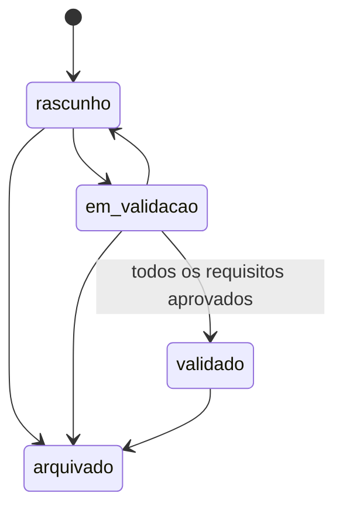

# 13. Framework de critérios

O framework de critérios implementa a seção 3.5 do TCC. Ele transpõe para a gestão do curso a lógica da auditoria de sistemas de gestão: os **requisitos** são as exigências normativas e de qualidade, as **evidências** são os documentos do curso e a **não conformidade** é o não atendimento de um requisito.

## 13.1 Requisito

Cada requisito é um item verificável isoladamente (seção 3.5, passos a e b). Campos (`backend/app/domain/framework.py`):

| Campo | Descrição |
|---|---|
| `codigo` | Identificador no formato `GRUPO-NN` (ex.: `REG-01`, `EXT-01`, `INEP-D1`, `I40-01`), único na versão |
| `grupo` | Prefixo do código (REG, EXT, DCN, EAD, INEP, I40, TEND...) |
| `fonte_documento`, `fonte_dispositivo` | Norma ou referência de origem e o artigo, parágrafo ou indicador |
| `texto` | Enunciado do requisito |
| `tipo` | `legal` (obrigação legal), `qualidade` (indicador INEP, conceito 1 a 5) ou `competencia` (Indústria 4.0) |
| `dimensao_inep`, `indicador_inep`, `peso_dimensao` | Só para `qualidade`. O peso é preenchido pela dimensão (30, 40, 30) quando omitido |
| `evidencia_esperada` | O que comprovaria o atendimento |
| `documentos_provaveis` | Tipos de documento institucional onde a evidência provavelmente está (`ppc`, `matriz`, `ementas`...) |
| `consulta_padrao`, `termos_chave` | Consulta padronizada para a recuperação de evidências (seção 3.6.1 b). Sem consulta, usa-se o texto e a evidência esperada |
| `gravidade_base` | 1 a 5. Sugere a nota G da matriz GUT |
| `prazo_referencia` | Prazo regulatório. Sugere a nota U da matriz GUT |
| `formatos` | Formatos de oferta a que se aplica (`presencial`, `semipresencial`, `distancia`). Vazio = todos |
| `situacao_normativa` | `vigente` ou `tendencia`. Normas em tramitação ficam fora do diagnóstico por padrão (seção 3.3) |
| `status_validacao`, `comentario_validacao` | Revisão do orientador: `pendente`, `aprovado` ou `ajustar` (passo c) |

## 13.2 Versões e validação

O framework é versionado (tabelas `framework_versoes` e `requisitos`):

- Versões **validadas** ou **arquivadas** são imutáveis. Para alterá-las, clona-se uma nova versão, cujos requisitos voltam para `pendente`.
- Uma única versão fica **ativa**; é a usada por padrão no diagnóstico, que registra a versão empregada.
- Alterar o conteúdo de um requisito aprovado o devolve para `pendente`.
- Pedir ajuste exige comentário.

## 13.3 Carga inicial, importação e exportação

Na primeira inicialização, sem nenhuma versão cadastrada, o sistema importa `data/framework/framework-v0.1.json` (configurável por `FRAMEWORK_SEED_FILE`). Esse rascunho contém os exemplos do Quadro 6 do TCC e requisitos derivados do corpus normativo das seções 3.3.1 e 3.4, todos **pendentes** de validação; os dispositivos (artigos e indicadores) devem ser completados pelos autores com o orientador.

- **JSON:** `POST /api/framework/importar` com `{versao, modo, requisitos: [...]}`. O modo `mesclar` atualiza pelo código e acrescenta os novos; `substituir` troca todos os requisitos da versão.
- **CSV:** `POST /api/framework/importar/csv`, separado por `;` (ou `,`), em UTF-8. Listas (`documentos_provaveis`, `termos_chave`, `formatos`) usam `|` como separador. A exportação CSV tem o mesmo formato, então o framework pode ser editado em planilha e reimportado.
- **Exportação:** `GET /api/framework/exportar?formato=json|csv` gera a versão completa para o apêndice do TCC.

A importação valida o lote inteiro e informa todos os erros de uma vez (códigos duplicados, tipos inválidos, dimensão INEP em requisito que não é de qualidade, tipos de documento fora do vocabulário etc.).

## 13.4 Arquitetura

- **Domínio** (`domain/framework.py`): entidades `Requisito`, `FiltroRequisitos`, `VersaoInfo` e as regras de validação e aplicabilidade, sem dependência de banco.
- **Porta** `FrameworkRepository` (`domain/ports.py`): `versao_ativa()`, `listar(filtros)`, `obter(codigo, versao)`. É a interface consumida pelo diagnóstico.
- **Adaptador** `SqlFrameworkRepository` (`repositories/framework_repository.py`).
- **Casos de uso** `FrameworkService` (`services/framework/framework_service.py`): versões, CRUD, validação, importação e exportação.
- **API**: `api/routers/framework.py` (ver [7. API](07-api.md)).

## 13.5 Recuperação de evidências por requisito

`EvidenceRetrievalService` (`services/framework/evidence_retrieval_service.py`) implementa a consulta orientada por requisito da seção 3.6.1 b. Para cada requisito:

1. monta a consulta padronizada (`consulta_padrao` e `termos_chave`; na falta, o texto e a evidência esperada);
2. faz uma busca vetorial restrita à coleção **institucional**, ao curso informado e aos `documentos_provaveis` do requisito;
3. faz uma segunda busca em toda a coleção institucional do curso, que cobre documentos sem tipo e evidências fora do lugar esperado;
4. une os candidatos sem duplicatas e os reordena com o reranker, mantendo os `top_n` mais relevantes acima da relevância mínima configurada.

Com `incluir_normativa`, recupera também até três trechos da coleção **normativa** com o texto de origem do requisito.

Cada evidência (`Evidencia`) traz documento, versão e hash do arquivo, página e localização, se veio de OCR, coleção, tipo e as pontuações vetorial e de rerank. O resultado detalhado (`RecuperacaoRequisito`) inclui ainda a consulta usada, os tempos de cada etapa e a configuração (modelos, `top_k`, `top_n`, número de candidatos), registrados pelo diagnóstico para reprodutibilidade (seção 3.8).

A pontuação `score` é a do reranker quando ele está ligado e a similaridade de cosseno quando não está; por isso, não se comparam pontuações entre execuções com configurações diferentes.

